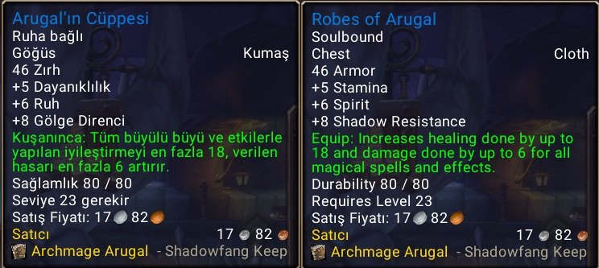
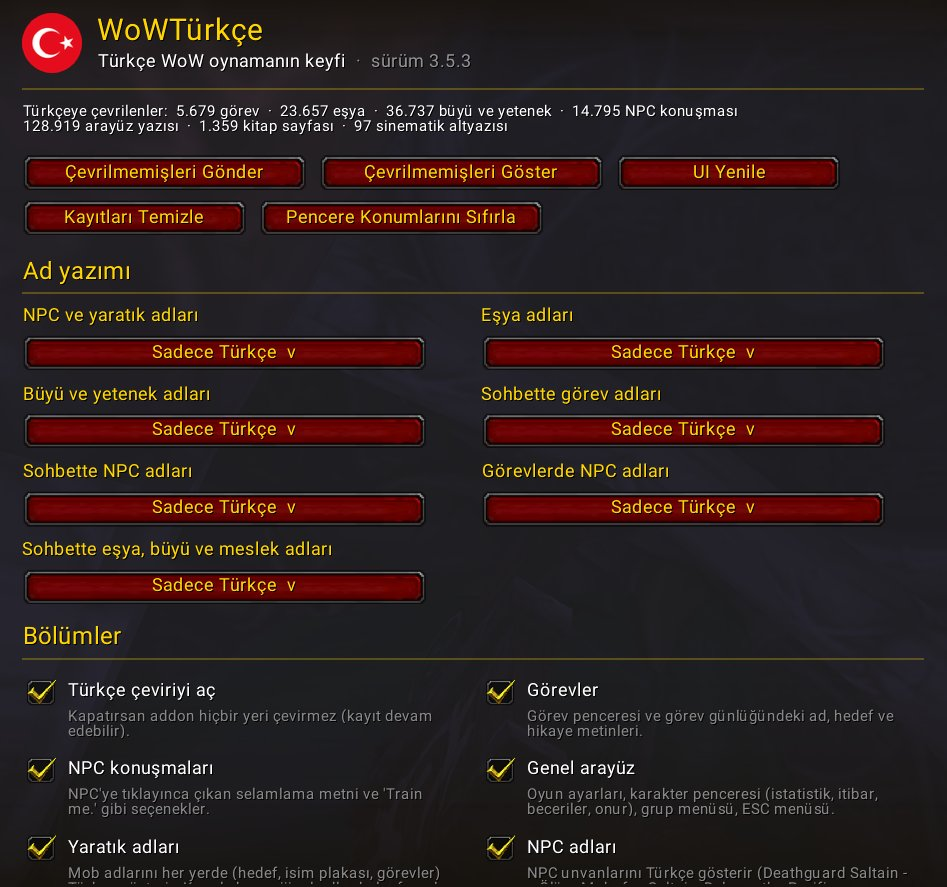

### ⚔️ World of Warcraft'ı Türkçe oyna

WoWTürkçe World of Warcraft: Forever'ı Türkçeye çevirir: arayüz, yaratık ve NPC adları, eşya adları ve eşya ipuçları. Oyun dosyalarına dokunmaz; yalnızca ekranda gördüğün yazıyı değiştirir ve istediğin an İngilizceye dönebilirsin.

### 📜 Neler çevriliyor

- 🖥️ **Arayüz:** oyun ayarları, karakter penceresi, itibar ve beceriler, grup menüsü, ESC menüsü ve sistem mesajları.
- ⚠️ **Hata ve bilgi mesajları:** ekranın ortasındaki "Yeterli mana yok", "Menzil dışında" gibi yazılar.
- 🐗 **Yaratık ve NPC adları:** hedef çerçevesi, isim plakaları ve ipuçlarında yaratık adları ve NPC unvanları.
- 🗡️ **Eşyalar:** eşya adları, eşya açıklamaları ve ipucu satırları (statlar, Kuşanıldığında ve Kullan satırları, set bonusları, gereksinimler).

Kişi, yer, sınıf ve boss adları İngilizce kalır. Lonca adlarına ve oyuncuların yazdıklarına asla dokunulmaz.

### 🔤 Türkçe karakterler

Eklenti tam Türkçe destekli yazı tipleriyle gelir; ğ, ş, ı ve İ harfleri asla kare görünmez. Diğer Türkçe eklentilerdeki harfleri de düzeltir.

### ⌨️ İngilizcesi için Alt tuşuna basılı tut

Alt tuşuna basılı tuttuğun sürece arayüz yazıları İngilizce görünür, bırakınca Türkçe geri gelir. İngilizce bir rehberi takip ederken ya da bir oyuncuyla görev hakkında konuşurken çok işe yarar.

### ✨ Kolaylıklar (hepsi isteğe bağlı)

- 🔨 **Satıcıda otomatik tamir ve gri eşyaları otomatik satma.**
- 🪟 **Taşınabilir pencereler:** Shift'i basılı tutup görev, konuşma ve satıcı pencerelerini istediğin yere sürükle.
- 🤫 **Sessiz giriş:** diğer eklentilerin sohbete yazdığı "yüklendi" mesajlarını gizle.

### ⚙️ Ayarlar ve komutlar

Ayarları Oyun Menüsü > Ayarlar > AddOns > WoWTürkçe'den ya da minimap düğmesine sol tıklayarak açabilirsin. Her bölüm ayrı ayrı açılıp kapatılabilir.

Minimap düğmesi: sol tık ayarları açar, sağ tık Türkçe ile İngilizce arasında geçer, Shift+sol tık çevrilmemiş metinleri gönderir.

### 🤝 Çeviriye katkı ver

Eklenti henüz çeviremediği bir metinle karşılaşınca onu kaydeder; oyuncu sohbetini asla kaydetmez. "Çevrilmemişleri Gönder"e tıkla ya da /wtr paylas yaz ve kısa kodu forma yapıştır. Bu metinler çevrilip bir sonraki güncellemeyle gelir.

### 📥 Kurulum

1. **Kurulum programı (önerilen):** [`WoWTurkce-Kurulum.exe`](WoWTurkce-Kurulum.exe) dosyasını indirip çalıştır. WoW klasörlerini kendisi bulur, eklentiyi kurar ve yeni sürüm çıkınca otomatik günceller.
2. **Elle kurulum:** [`WoWTurkce.zip`](WoWTurkce.zip) dosyasını indir ve içindeki WoWTurkce klasörünü `World of Warcraft\_forever_\Interface\AddOns` içine kopyala.
3. Yeni dosya ekleyen bir güncellemeden sonra oyunu tamamen kapatıp yeniden aç.

> Windows "bilinmeyen yayıncı" uyarısı verebilir; program imzasız olduğu için bu normaldir.

### ❤️ Teşekkürler

Yapımcı: Erkin Azcan
erkinazcan@gmail.com
