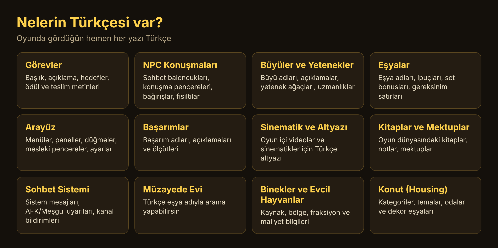
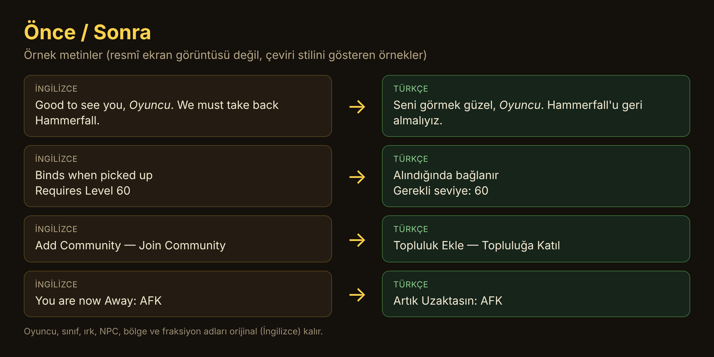
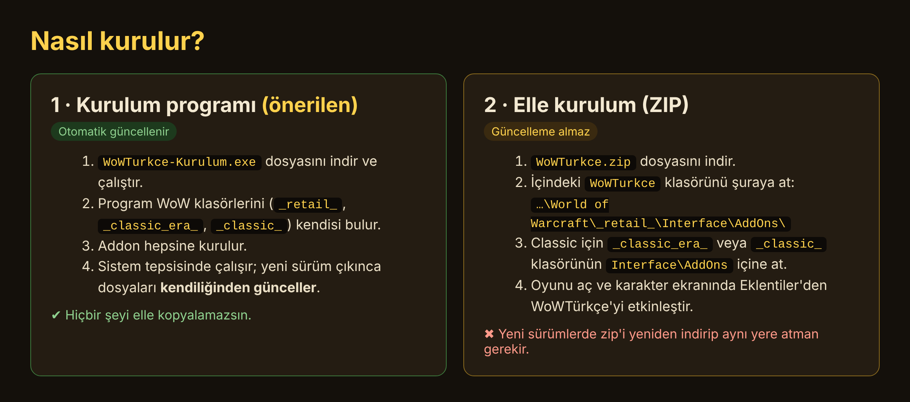

# WoWTürkçe — World of Warcraft Türkçe Yama

**World of Warcraft'ı neredeyse %100 Türkçe oyna.** Görevlerden NPC konuşmalarına, büyülerden eşya ipuçlarına, arayüzden başarımlara kadar oyunda gördüğün yazıların büyük çoğunluğu Türkçe.

Desteklenen sürümler: **Classic Era**, **Classic (Forever)** ve **Retail (Midnight)**.

## Çeviri tarzı

- Oyuncu, sınıf, ırk, NPC, bölge ve fraksiyon adları orijinal (İngilizce) kalır; yani oyundaki isimleri tanımakta zorlanmazsın.
- Genel terimler tutarlı Türkçe karşılıklarla kullanılır (Lonca, Zindan, Müzayede Evi, Başarım, Mitik, Arkan, Ün, Savaş Grubu vb.).
- Metinler oyun içi bağlama göre, doğal ve akıcı Türkçe ile çevrilir.

## Kurulum

### 1) Kurulum programı (önerilen)

[`WoWTurkce-Kurulum.exe`](WoWTurkce-Kurulum.exe) dosyasını indirip çalıştırman yeterli.

- Bilgisayarındaki WoW klasörlerini (`_retail_`, `_classic_era_`, `_classic_`) kendisi bulur ve addon'u hepsine kurar.
- Windows ile birlikte açılır, sistem tepsisinde çalışır.
- **Yeni sürüm çıktığında addon dosyalarını otomatik olarak günceller.** Sen hiçbir şey yapmazsın.
- Retail'e özel dosyalar yalnızca `_retail_` klasörüne kurulur.
- Dosyanın Özellikler → Ayrıntılar sekmesinde addon sürümü yazar.

> Windows "bilinmeyen yayıncı" uyarısı verirse, program imzasız olduğu içindir. Kaynak kodu güvenle incelenebilir, program yalnızca bu depodan indirip WoW klasörlerine dosya yazar.

### 2) Elle kurulum (ZIP)

Kurulum programını kullanmak istemiyorsan:

1. [`WoWTurkce.zip`](WoWTurkce.zip) dosyasını indir.
2. İçindeki **`WoWTurkce`** klasörünü şu klasöre kopyala:
   - Retail: `...\World of Warcraft\_retail_\Interface\AddOns\`
   - Classic Era: `...\World of Warcraft\_classic_era_\Interface\AddOns\`
   - Classic (Forever): `...\World of Warcraft\_classic_\Interface\AddOns\` (klasör adın farklıysa ilgili sürümün `Interface\AddOns` klasörü)
3. Oyunu aç, karakter seçim ekranında **Eklentiler** bölümünden *WoWTürkçe*'nin açık olduğundan emin ol.

> ⚠️ **ZIP ile kurulumda otomatik güncelleme yoktur.** Yeni sürümlerde ZIP'i tekrar indirip aynı yere atman gerekir. Otomatik güncelleme istiyorsan kurulum programını kullan.

## Eksik veya İngilizce bir yer mi gördün?

Çeviri sürekli büyüyor; oyun çok büyük olduğu için bazı metinler hâlâ İngilizce kalmış olabilir. Böyle bir yer görürsen lütfen bize bildir, bir sonraki sürümde çevirelim:

1. Bu sayfanın üstündeki **Issues** sekmesinden yeni bir konu aç.
2. Metnin **ekran görüntüsünü** ekle ve nerede gördüğünü kısaca yaz (hangi sürüm, hangi pencere, hangi görev/NPC/eşya).
3. Mümkünse ekran görüntüsünde karakter adın ve özel bilgilerin görünmediğinden emin ol.

Kurulum programının arka plan izleme (`--izle`) özelliğini açarsan, oyundan çıkınca çevirisi eksik **oyun metinlerinin** kodları toplanır ve istersen otomatik gönderilir. Sohbet ve kişisel veri bu kodlara girmez; göndermeyi kapatmak için programın yanındaki `WoWTurkce.json` dosyasında `"gonder": false` yapabilirsin.

## Sık sorulanlar

**Oyun güncellenince bozulur mu?** Oyun yamasından sonra yeni içerik İngilizce görünebilir; çeviriler yeni sürümlerle eklenir. Kurulum programı varsa güncellemeler otomatik gelir.

**Kaldırmak istersem?** `Interface\AddOns\WoWTurkce` klasörünü sil (ve kurulum programını tepsiden çıkarıp kaldır).

---

Hazırlayan: **Erkin Azcan**
