
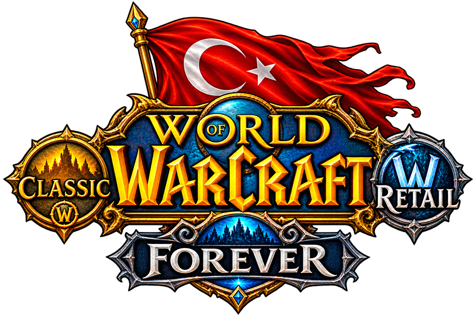

### ⚔️ World of Warcraft'ı Türkçe oyna

WoWTürkçe oyunu baştan sona Türkçeye çevirir: görevler, NPC konuşmaları, arayüz, eşya ve büyü ipuçları, kitaplar ve sinematik altyazılar. Oyun dosyalarına dokunmaz; yalnızca ekranda gördüğün yazıyı değiştirir ve istediğin an İngilizceye dönebilirsin.

WoW Classic Forever için yapıldı; Classic Era ve Retail'de de çalışır.

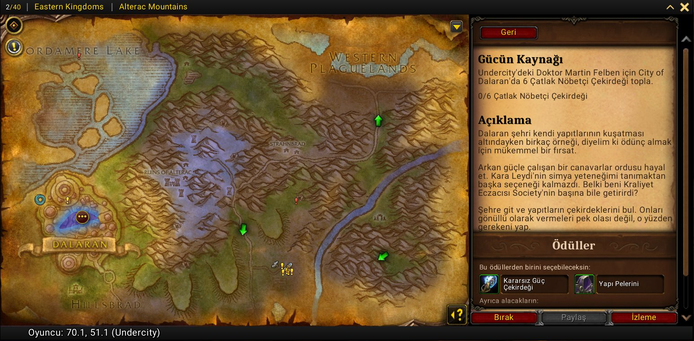

### 📜 Neler çevriliyor

- 📖 **Görevler:** görev penceresinde, görev günlüğünde ve görev takipçisinde başlık, hedef, açıklama, ilerleme ve bitiş yazıları. Yeni Zephras ve Skyborne hikayeleri dahil tüm Forever görevleri.
- 💬 **NPC konuşmaları:** selamlama metinleri ve konuşma seçenekleri ("Mallarına bakmak istiyorum." gibi).
- 🗣️ **NPC sözleri:** yaratık ve NPC'lerin söylediği, bağırdığı ve duygu mesajları; hem sohbet penceresinde hem de başlarının üstündeki konuşma balonunda.
- 🗡️ **İpuçları:** eşya statları, Kuşanınca ve Kullan satırları, hikâye yazıları, büyü ve yetenek açıklamaları.
- 🔮 **Büyü kitabı ve büyü çubuğu:** büyü adları, dereceler ve sekmeler; aynı karede çevrildiği için titreme olmaz.
- 🖥️ **Arayüz:** oyun ayarları, karakter penceresi, itibar ve beceriler, grup menüsü, ESC menüsü, hata mesajları ve sohbetteki sistem mesajları.
- 📚 **Kitaplar ve mektuplar:** okunabilir eşyalar, notlar ve tabelalar.
- 🎬 **Sinematikler:** film ve ara sahne altyazıları.
- 🧭 **Minimap:** minimap üzerinde gezinince çıkan yaratık, NPC, bitki, maden ve görev noktası adları.

Kişi, yer, sınıf, görev, eşya ve boss adları ile boss yetenekleri İngilizce kalır; böylece diğer oyuncularla konuşabilir ve rehberlerde arama yapabilirsin. Lonca adlarına ve oyuncuların yazdıklarına asla dokunulmaz.

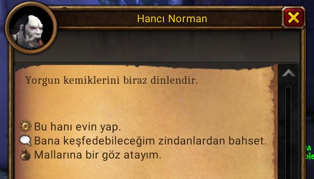

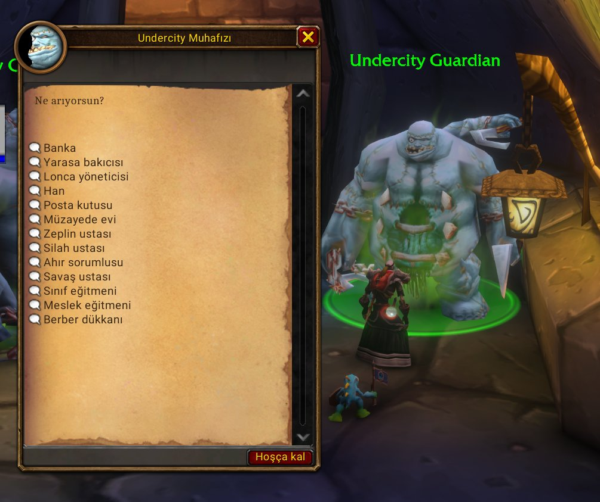

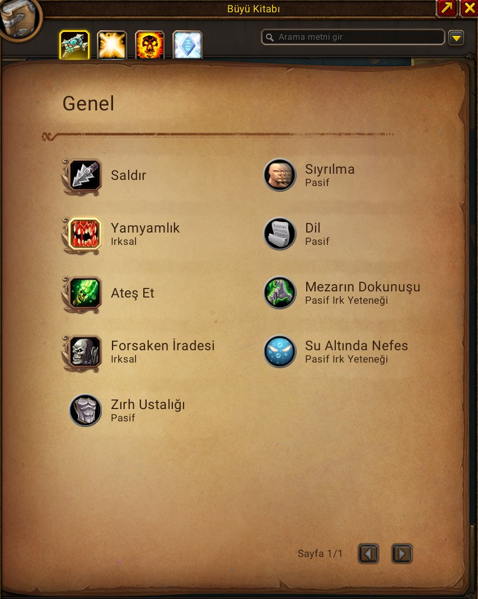

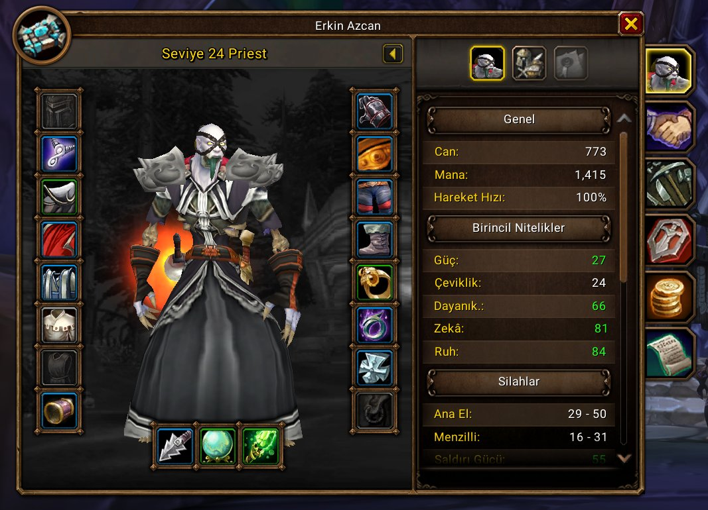

### 🔤 Türkçe karakterler

Eklenti tam Türkçe destekli yazı tipleriyle gelir; ğ, ş, ı ve İ harfleri asla kare görünmez. Diğer Türkçe eklentilerdeki harfleri de düzeltir.

### ⌨️ İngilizcesi için Alt'ı basılı tut

Alt'ı basılı tuttuğun sürece her şey İngilizce görünür, bırakınca Türkçe geri gelir. İngilizce bir rehberi takip ederken ya da bir oyuncuyla görev hakkında konuşurken çok işe yarar.

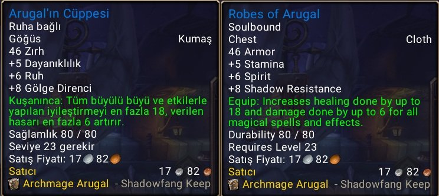

### ✨ Kolaylıklar (hepsi isteğe bağlı)

- 🦅 **Uçuş süreleri:** uçuş haritasında her noktanın süresi yazar, uçarken kalan süreyi bir çubuk gösterir. Süreler kendi uçuşlarından öğrenilir.
- 🔨 **Satıcıda otomatik tamir ve gri eşyaları otomatik satma.**
- 🪟 **Taşınabilir pencereler:** Shift'i basılı tutup görev, konuşma ve satıcı pencerelerini istediğin yere sürükle.
- 🤫 **Sessiz giriş:** diğer eklentilerin sohbete yazdığı "yüklendi" mesajlarını gizle.

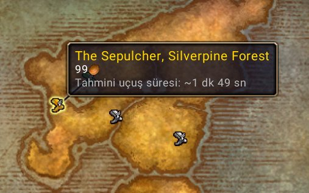

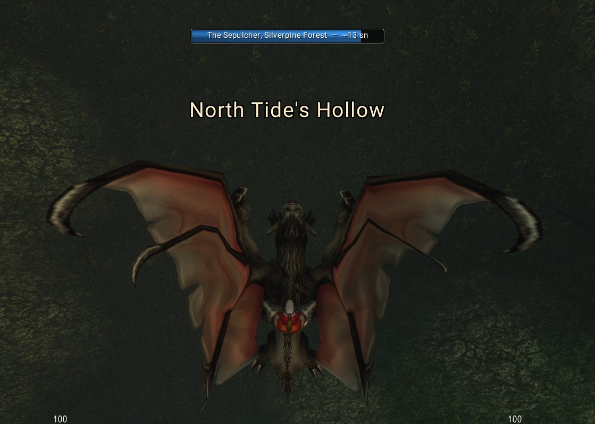

### ⚙️ Ayarlar ve komutlar

Ayarları Oyun Menüsü > Ayarlar > AddOns > WoWTürkçe'den ya da minimap düğmesine sol tıklayarak açabilirsin. Her bölüm ayrı ayrı açılıp kapatılabilir.

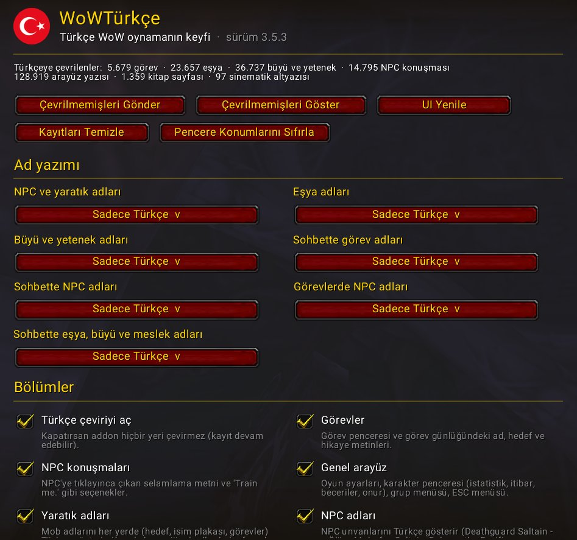

| Komut | Ne yapar |
| --- | --- |
| /wtr | Durum ve yardım |
| /wtr ayar | Ayarlar panelini aç |
| /wtr tr, /wtr en | Türkçeyi aç ya da her şeyi İngilizce göster |
| /wtr konum | İpucunun yerini değiştir (fare, orta alt, sağ üst…) |
| /wtr pencere sifirla | Taşınan pencereleri eski yerine döndür |
| /wtr paylas | Çevrilmemiş metinleri yapımcıya gönder |

Minimap düğmesi: sol tık ayarları açar, sağ tık Türkçe ile İngilizce arasında geçer, Shift+sol tık çevrilmemiş metinleri gönderir.

### 🤝 Çeviriye katkı ver

Eklenti henüz çeviremediği bir metinle karşılaşınca onu kaydeder; oyuncu sohbetini asla kaydetmez. "Çevrilmemişleri Gönder"e tıkla ya da /wtr paylas yaz ve kısa kodu forma yapıştır. Bu metinler çevrilip bir sonraki güncellemeyle gelir.

### 📥 Kurulum

1. **Kurulum programı (önerilen):** [`WoWTurkce-Kurulum.exe`](WoWTurkce-Kurulum.exe) dosyasını indirip çalıştır. WoW klasörlerini kendisi bulur, eklentiyi kurar ve yeni sürüm çıkınca otomatik günceller.
2. **Elle kurulum:** [`WoWTurkce.zip`](WoWTurkce.zip) dosyasını indir ve içindeki WoWTurkce klasörünü `World of Warcraft\_forever_\Interface\AddOns` içine kopyala.
3. Yeni dosya ekleyen bir güncellemeden sonra oyunu tamamen kapatıp yeniden aç.

> Windows "bilinmeyen yayıncı" uyarısı verebilir; program imzasız olduğu için bu normaldir.

### 🧩 Türkçe eklenti paketi (WoWTurkceAddonlar)

WoWTürkçe hızlı kalsın diye diğer eklentileri kendisi çevirmez. Onların Türkçe dosyaları kendi sürüm numarası olan ayrı bir paketle gelir: **WoWTurkceAddonlar**.

| Grup | Eklentiler |
| --- | --- |
| Görev ve harita | Questie, QuestieTrace, TomTom, Leatrix_Maps, ForeverDungeonJournal |
| Raid ve zindan | BigWigs, DBM-Core, DBM-GUI, Capping |
| Birim çerçeveleri ve iyileştirme | ZPerl (ZPerl_Options, ZPerl_RaidAdmin, ZPerl_RaidFrames, ZPerl_RaidHelper, ZPerl_RaidMonitor ile), VuhDo, VuhDoOptions, IceHUD |
| Hasar ölçerler | Details (Details_Compare2, Details_EncounterDetails, Details_RaidCheck, Details_Streamer, Details_TinyThreat, Details_Vanguard ile) |
| Çanta, mezat ve ganimet | Baganator, Syndicator, Auctionator, AtlasLootClassic, AtlasLootContinued, AtlasBIStooltips |
| Arayüz ve sohbet | Bartender4, MoveAny, MinimapButtonButton, Prat-3.0 |
| Balıkçılık | ForeverFishing, BetterFishing |

Nasıl kurulur:

1. İstediğin eklentileri her zamanki gibi kur. Pakette eklentilerin kendisi yok, yalnızca çevrilmiş dosyaları var.
2. Bu sayfadan en güncel `WoWTurkceAddonlar-<sürüm>.zip` dosyasını indir.
3. Zip'i aç ve içindeki klasörleri `World of Warcraft\_forever_\Interface\AddOns` içine kopyala. Windows sorunca "Değiştir"i seç.
4. Oyunu başlat ya da /reload yaz. Sende kurulu olmayan eklentilerin dosyaları bir şey yapmaz.

Dosyalar paketin hazırlandığı andaki eklenti sürümlerine göredir. Bir eklenti hata verirse o eklentiyi yeniden kurman yeterli, İngilizce hali geri gelir. Bir eklentiyi güncellediğinde Türkçe dosyaları da silinir; güncellemeden sonra paketi yeniden kopyala.

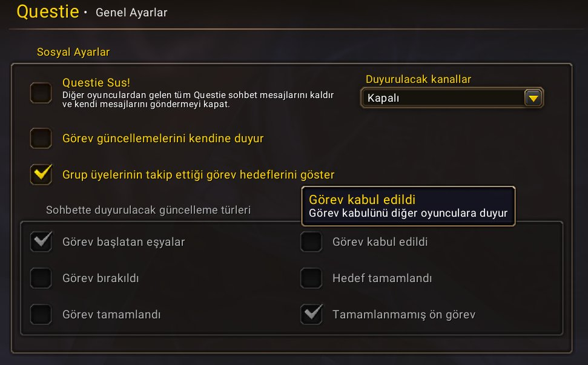

### ❤️ Teşekkürler

Yapımcı: Erkin Azcan. Yazı tipleri: Caladea ve Carlito (SIL Open Font License 1.1). Sıkıştırma: LibDeflate. Forever görev ve konuşma metinlerinin bir kısmı Efficient Games'in EG Link veri setinden alınmıştır (CC BY 4.0).
